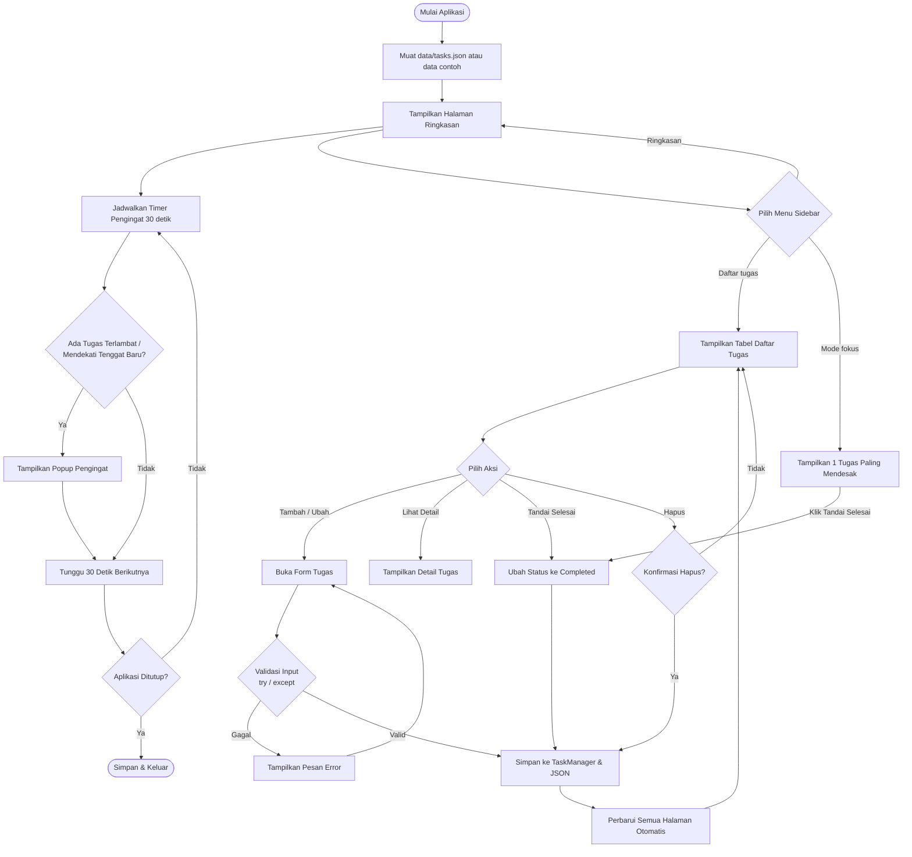

# Flowchart — Smart To-Do with Reminders

Diagram berikut menggambarkan alur utama aplikasi mulai dari inisialisasi data, navigasi antar layar, pengelolaan tugas (CRUD) dengan validasi, hingga pengecekan pengingat popup secara berkala.

